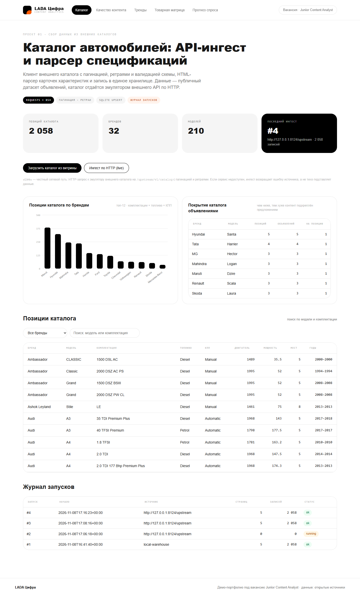
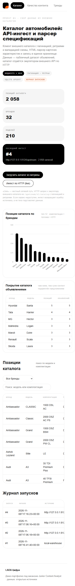
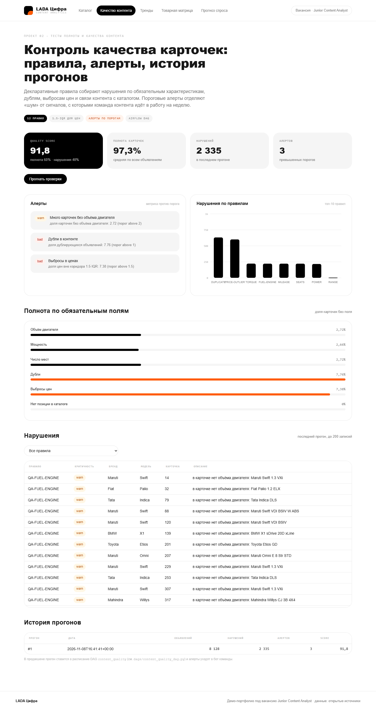
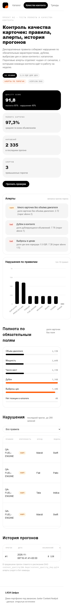
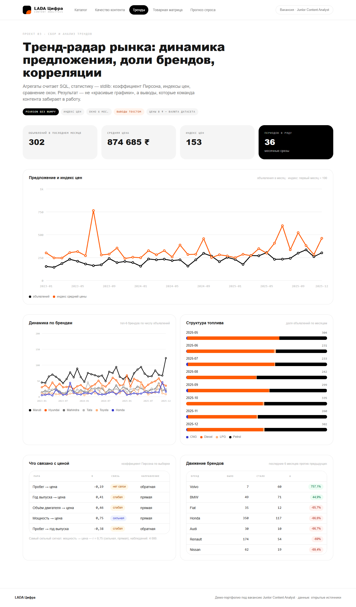
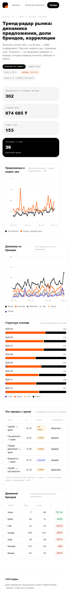
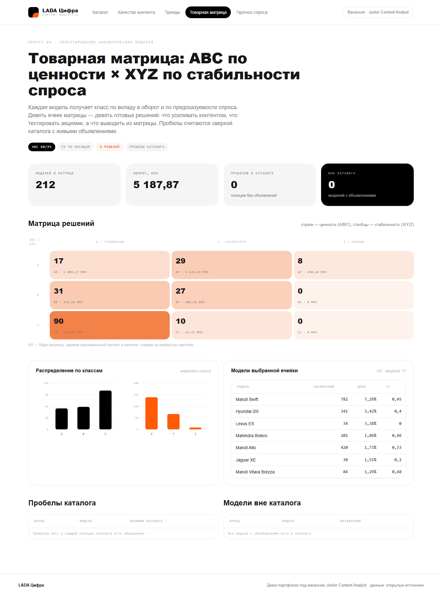
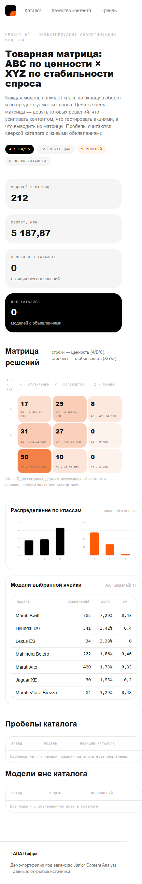
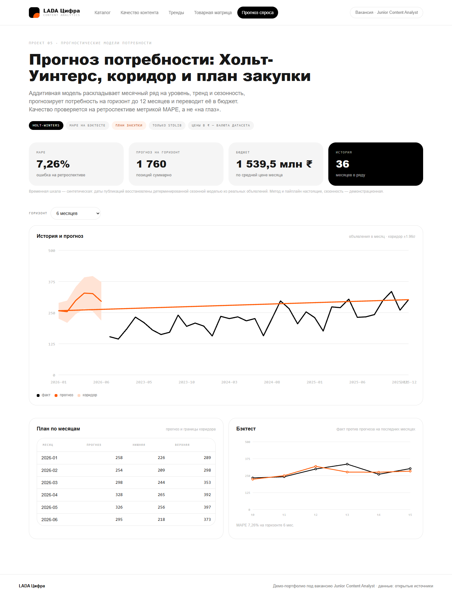
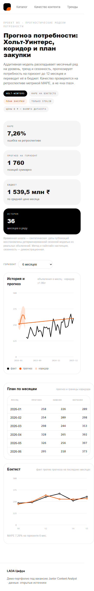

# LADA Цифра · Content Analytics

Портфолио под вакансию **Junior Content Analyst** (LADA Цифра, группа «АВТОВАЗ»):
пять рабочих сервисов на стыке аналитики контента и инженерии данных, с бэкендом, интерфейсом
и тестами. Всё запускается локально одной командой.

Интерфейс собран в визуальном языке [ladadigit.ru](https://ladadigit.ru): белое полотно,
графитовые акценты `#171717` / `#000`, оранжевый `#ff5b06`, скругления 24–32 px, Roboto
и моно-акценты для служебных подписей.

---

## Пять проектов — пять пунктов вакансии

| # | Проект | Что закрывает из вакансии | Страница |
|---|--------|---------------------------|----------|
| 01 | `projects/catalog_api` | исследование и сбор данных из внешних каталогов по API, парсеры сайтов | `/catalog` |
| 02 | `projects/content_qa` | тесты полноты и качества контента, алерты об ошибках и пропусках, Airflow DAG | `/qa` |
| 03 | `projects/trend_radar` | сбор и анализ трендов, корреляции | `/trends` |
| 04 | `projects/matrix_optimizer` | аналитические модели для оптимизации товарной матрицы | `/matrix` |
| 05 | `projects/demand_forecast` | прогноз потребности и продаж | `/forecast` |

Общие требования вакансии, закрытые в коде: Python, SQL, парсинг `HTML`/`JS`-страниц
(BeautifulSoup), HTTP-клиенты с ретраями, дашборды, быстрый код на больших выборках
(агрегаты считает SQLite, статистика — stdlib, без pandas/numpy).

---

## Быстрый старт

```powershell
python -m venv .venv
.\.venv\Scripts\python.exe -m pip install -r requirements-dev.txt

.\.venv\Scripts\python.exe -m scripts.migrate                      # схема и вьюхи
.\.venv\Scripts\python.exe -m scripts.build_dataset                # CSV -> data/warehouse.sqlite
.\.venv\Scripts\python.exe -m uvicorn app:app --port 8000
```

Или контейнером:

```powershell
docker compose up --build        # миграции, сборка витрины, uvicorn на :8000
```

Открыть `http://127.0.0.1:8000/` — приложение перебросит на каталог.

Проверки:

```powershell
.\.venv\Scripts\python.exe -m pytest -q              # 353 теста
.\.venv\Scripts\python.exe -m ruff check .           # линтер, 0 замечаний
.\.venv\Scripts\python.exe tools\style_check.py       # собственные правила стиля, 0 замечаний
```

Тесты лежат в двух местах: `projects/*/tests` — доменная логика каждого сервиса,
`tests/` — общий слой (`shared/`, `app.py`, `scripts/`, `tools/`) и инфраструктура.

---

## Откуда данные

| Слой | Источник | Честность |
|------|----------|-----------|
| Объявления (марка, модель, год, цена, пробег, топливо, КПП, двигатель) | публичный датасет объявлений авторынка (8 128 записей), зеркало открытой выгрузки | реальные данные, без правок значений |
| Внешний каталог | эмулятор стороннего API `/upstream/v1/catalog` | каталог собирается из витрины: реальные комбинации марка + модель + комплектация + топливо + КПП с усреднёнными характеристиками |
| Даты публикаций | детерминированная сезонная модель | **синтетическая шкала**: нужна для месячных рядов и прогноза, в БД помечена `listed_at_source = 'simulated'` |
| Валюта | исходная валюта датасета | конвертация не выполняется, чтобы не выдумывать курс |

Почему каталог отдаёт наш же сервис: у машины, где собирался проект, нет доступа к внешним
автомобильным API (NHTSA vPIC и аналоги отваливаются по таймауту), а Kaggle требует токен —
поэтому путь «HTTP → пагинация → ретраи → разбор JSON» проверяется на эмуляторе, который
отдаёт данные **по-настоящему по сети**. Клиент `HttpCatalogSource` рассчитан на реальный API:
достаточно поменять `base_url`. Никаких тихих подстановок: если источник недоступен, ингест
падает с `CatalogUnavailableError`, а не показывает выдуманные цифры.

---

## Что внутри каждого проекта

### 01. Каталог — `projects/catalog_api`

- `sources.py` — контракт `CatalogSource`, HTTP-клиент с таймаутом, тремя ретраями и
  нарастающей паузой, плюс локальная реализация для офлайн-режима.
- `parser.py` — парсер HTML-карточек характеристик: селекторы в конфиге, «1 598 см³» → `1598`,
  пустое поле → `None`, деление позиций на полные и неполные.
- `upstream.py` — эмулятор внешнего каталога с пагинацией и валидацией среза.
- `service.py` — идемпотентный `UPSERT`, журнал запусков `ingest_runs`, поиск с фильтрами.
- Страница: KPI, топ брендов по числу позиций, покрытие каталога объявлениями, поиск, журнал.

### 02. Качество контента — `projects/content_qa`

- 12 декларативных правил: пропуски характеристик, дубли карточек, выбросы цен по `1.5·IQR`,
  невозможные год и пробег, объявления без позиции в каталоге.
- Пороговые алерты: полнота ниже 95 %, пропуски двигателя > 2 %, дубли > 1 %, выбросы > 1.5 %,
  разрыв с каталогом > 5 %.
- Итоговый `quality_score` = 60 % полноты + 40 % отсутствия нарушений.
- `dags/content_quality_dag.py` — DAG с прогоном проверок и падением задачи при критичных алертах.

### 03. Тренды — `projects/trend_radar`

- Месячный ряд предложения и индекс цен (первый период = 100).
- Доли брендов, структура топлива, «движение» брендов: последние 6 месяцев против предыдущих.
- Коэффициент Пирсона для пар «пробег → цена», «год → цена», «объём → цена», «мощность → цена»,
  «пробег → год» с интерпретацией силы и направления связи.

### 04. Товарная матрица — `projects/matrix_optimizer`

- ABC по вкладу в оборот (80/95) × XYZ по коэффициенту вариации месячного спроса.
- Девять ячеек — девять готовых решений (что усиливать контентом, что тестировать, что выводить).
- Пробелы ассортимента: позиции каталога без объявлений и модели с объявлениями вне каталога.

### 05. Прогноз потребности — `projects/demand_forecast`

- Аддитивная модель Хольта-Уинтерса на stdlib: уровень, тренд, сезонность, `alpha/beta/gamma`.
- Горизонт 3–12 месяцев, доверительный коридор `±1.96σ` по остаткам, MAPE на ретроспективе
  (на текущих данных ≈ 7 %).
- Перевод прогноза в план: количество позиций и бюджет по средней цене месяца.
- Защита от короткой истории: длина сезона ужимается автоматически, пустой ряд не роняет сервис.

---

## Скриншоты

Сняты скриптом `tools/shots.py` (Playwright, Chromium) на живом приложении:
десктоп 1440 px и мобильный 390 px. Ошибки консоли и упавшие запросы собираются
в `docs/screens/console.json` — там пусто.

| Проект | 1440 px | 390 px |
| --- | --- | --- |
| 01. Каталог |  |  |
| 02. Качество контента |  |  |
| 03. Тренды |  |  |
| 04. Товарная матрица |  |  |
| 05. Прогноз потребности |  |  |

Пересобрать: `python -m uvicorn app:app --port 8125`, затем
`python -m tools.shots --base http://127.0.0.1:8125 --out docs/screens`.

---

## Правила кода

Линтер — `ruff` со строгим набором (`E,F,W,I,N,UP,B,SIM,RET,C90,ANN,ARG,PLR,RUF,S`),
длина строки 100, сложность ≤ 5. Плюс собственный чекер `tools/style_check.py`:

- **STYLE001** — не больше двух операторов в теле функции (в тестах — шести, в DAG — четырёх);
- **STYLE002** — один выход: `return`/`break`/`continue` не больше одного (`raise` — аварийный
  путь, а не альтернативный возврат);
- **STYLE003** — тело не длиннее 10 строк (тесты — 24, DAG — 24).

Отсюда декомпозиция: вместо «функции на 40 строк» — цепочка маленьких именованных шагов
(`projected`, `seasonal`, `blend`, `where_text`), которую видно в диффе.

---

## Продакшен-обвязка

Приложение собирается в образ `python:3.12-slim`, работает не от root, а старт контейнера —
`docker/entrypoint.sh`: миграции → сборка витрины при первом запуске → `uvicorn` с N воркерами.

| Переменная | По умолчанию | Смысл |
| --- | --- | --- |
| `LADA_ENV` | `dev` | режим, попадает в `/health` |
| `LADA_LOG_LEVEL` | `INFO` | уровень структурных логов |
| `LADA_HOST` / `LADA_PORT` | `127.0.0.1` / `8000` | адрес uvicorn |
| `LADA_WORKERS` | `1` | число процессов uvicorn |
| `LADA_DATA_DIR` | `data/` | каталог витрины и исходников |
| `LADA_CSV` | `<data>/raw/car_details_v3.csv` | исходная выгрузка |
| `LADA_WAREHOUSE` | `<data>/warehouse.sqlite` | файл SQLite |

- **Миграции** — `sql/migrations/*.sql` и `python -m scripts.migrate`. Применённые версии
  пишутся в `schema_migrations`, повторный запуск ничего не делает; `scripts.build_dataset`
  поднимает базу теми же миграциями, поэтому схема описана в одном месте.
- **Логи** — одна JSON-строка на событие (`shared/logs.py`), каждый HTTP-запрос пишется
  с методом, путём, статусом и длительностью.
- **Проверки живости** — `/health` (живость и наличие витрины, при отсутствии схемы отвечает
  `degraded`) и `/ready` (миграции + непустая витрина, иначе `503`); оба используются
  в `HEALTHCHECK` образа и в `docker-compose.yml`.
- **CI** — `.github/workflows/ci.yml`: `ruff`, `style_check`, сборка витрины и `pytest`
  на Python 3.11 и 3.12, затем сборка образа и дымовой запрос к `/ready`.
- **Зависимости** разделены: `requirements.txt` — только рантайм, `requirements-dev.txt` —
  тесты, линтер и Playwright для скриншотов.

---

## Структура

```
app.py                      единое FastAPI-приложение, монтирует 5 сервисов, логи, /health, /ready
shared/                     конфиг из окружения, доступ к SQLite, логи, рендер страниц, дизайн-система
  static/css/lada.css       фирменный стиль (палитра и типографика ladadigit.ru)
  static/js/charts.js       SVG-графики без внешних зависимостей
sql/migrations/             0001 схема и 0002 вьюхи (источники для Superset/Power BI)
scripts/migrate.py          применение миграций с учётом версий
projects/catalog_api/       проект 01 + эмулятор внешнего API
projects/content_qa/        проект 02
projects/trend_radar/       проект 03
projects/matrix_optimizer/  проект 04
projects/demand_forecast/   проект 05
dags/                       два Airflow DAG (каталог, качество контента)
scripts/build_dataset.py    сборка витрины из CSV миграциями
tools/style_check.py        собственные правила стиля
tests/                      общий слой и инфраструктурные проверки
Dockerfile, docker-compose.yml, docker/entrypoint.sh   запуск одной командой
.github/workflows/ci.yml    линтер, стиль, тесты, сборка образа
data/raw/                   исходная выгрузка
```

---

## Ограничения

- 8 128 объявлений — демонстрационный, не продакшен-объём; на больших таблицах те же запросы
  остаются в SQLite, но потребуют индексов под конкретные фильтры и партиционирования по периодам.
- Airflow-зависимости в `requirements.txt` нет: DAG-файлы проверяются статически (компиляция,
  `dag_id`, связка с сервисами) и запускаются в контуре, где Airflow установлен.
- Дата публикации синтетическая — прогноз демонстрирует метод, а не реальную сезонность рынка.
  Для боевого прогноза нужна настоящая история публикаций и сделок.
